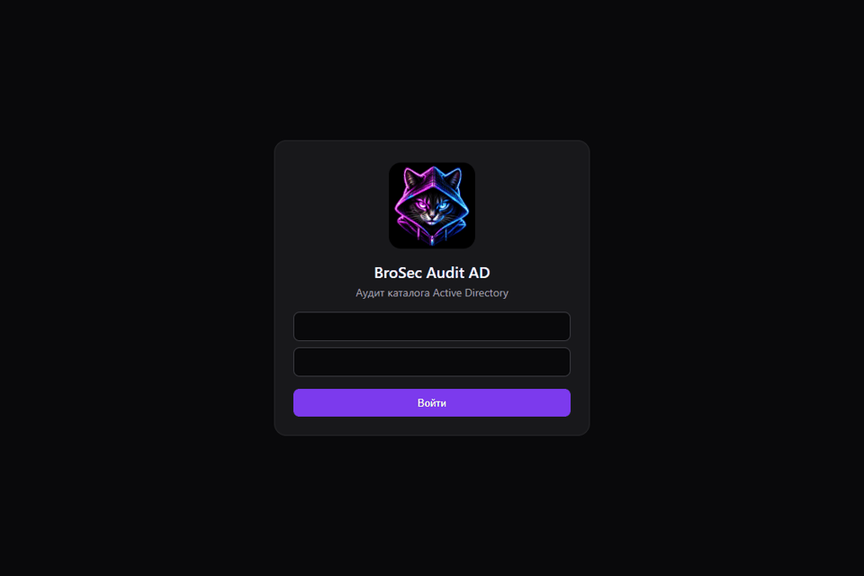

# 🛡️ BroSec Audit AD

Консоль аудита Active Directory для отдела безопасности. Linux-сервер читает каталог по LDAP или LDAPS, снимает позу контроллера по WinRM и складывает находки в одну картотеку. Рядом со справочником лежит база знаний: что означает проверка, чем она кончается и готовый текст письма администраторам. Почта и Telegram включаются по событиям, а не одним общим тумблером.

Интерфейс на русском и английском, три темы. Отчёты и справочник остаются на русском. Текущая версия в коде: **2.6.24**. История: [CHANGELOG.md](CHANGELOG.md).



Ролик в тёмной теме: секунда на входе, секунда на обзоре, секунда в каталоге. Названия компании, домена и узлов закрыты.

## Быстрый запуск одной командой

Поддерживаемая цель: Linux x86-64 (Ubuntu 22.04/24.04), Docker Engine 24+,
Docker Compose **2.20+**, Git и Bash. Docker должен быть запущен и доступен текущему
пользователю. Нужен исходящий HTTPS для GitHub, Docker Hub, PyPI и репозитория Debian.
Минимум: 4 CPU, 8 ГБ RAM, 40 ГБ диска; рекомендуем 8 CPU, 16 ГБ RAM, 80 ГБ диска.
Порт 9443 должен быть свободен. Windows/macOS и ARM не проверены; поставляемый
Linux-движок коллектора рассчитан на x86-64.

```bash
git clone https://github.com/cyb3rpeace/BroSecurityADAudit.git && cd BroSecurityADAudit && bash install.sh
```

Скрипт **не устанавливает Docker**, не изменяет firewall, не подключается к домену и
не запускает сбор на рабочих станциях. Он проверяет Docker/Compose, создаёт `.env`
со случайным секретом сессии (права 600), собирает образ, инициализирует отдельные
постоянные Docker volumes и запускает API с Threat Hunting worker. Worker ждёт
готовности API. При ошибке сборки или readiness команда завершается ненулевым кодом.
Повторный запуск не меняет существующие секреты и не удаляет данные.

Откройте `https://IP-АДРЕС-СЕРВЕРА:9443`. Начальный TLS-сертификат самоподписанный:
предупреждение браузера ожидаемо, но перед рабочим использованием замените его
сертификатом вашей организации. Открывайте доступ к 9443 только доверенным сетям.

Логин первого пользователя: `admin`. Случайный начальный пароль не печатается в логи
установщика. Получите его на сервере и смените после входа:

```bash
docker compose exec ad-security-core cat /opt/ad-audit/data/initial-admin.txt
```

Если вы заранее задали `INITIAL_ADMIN_PASSWORD` в `.env`, файл с паролем не создаётся.
Эта переменная действует только при создании пустой БД, а не сбрасывает пароль при обновлении.
Не присылайте пароль и содержимое `.env` в issues или чат.

В «Настройках» создайте компанию и настройте LDAPS/LDAP и разрешённые проверки.
SMTP, Telegram и AI API настраиваются для компании через авторизованный интерфейс.
Ollama для запуска не требуется. Проверка TLS LDAP/WinRM по умолчанию включена;
для корпоративного CA настройте доверие к нему, а не отключайте проверку без необходимости.

### Управление установкой

```bash
docker compose ps
docker compose logs --tail=100 ad-security-core ad-security-pipeline-worker
docker compose stop
docker compose start
```

Для другого порта измените `HTTPS_PORT` в `.env`, например `HTTPS_PORT=10443`, и
повторите `bash install.sh`. `BIND_ADDRESS=127.0.0.1` ограничивает публикацию localhost,
что подходит для HTTPS reverse proxy. Secure cookies требуют HTTPS.

### Обновление и резервная копия

Перед обновлением сохраните `.env` в защищённое место и сделайте согласованную
резервную копию volumes `data`, `reports` и `certs` при остановленных API и worker.
`data` содержит SQLite, ключи тенантов и архивы Threat Hunting: потеря ключей означает
потерю возможности расшифровать архивы. Не публикуйте резервные копии.
После резервирования запустите:

```bash
git pull --ff-only && bash install.sh
```

`docker compose down` сохраняет named volumes; **`docker compose down -v` удаляет
данные и ключи без возможности восстановления без резервной копии**. Не используйте
`-v` при обновлении. Имена volumes зависят от Compose project (`brosec-audit` по умолчанию).
Не меняйте project name для существующей установки без плана переноса данных.

### Если запуск не удался

- `docker info` — доступен ли daemon и есть ли права у пользователя.
- `docker compose version` — установлен ли Compose 2.20+.
- `docker compose ps -a` и `docker compose logs --tail=100` — ошибка init/API/worker.
- Занятый порт — измените `HTTPS_PORT` в `.env`.
- Ошибка LDAPS/WinRM TLS — проверьте DNS, срок сертификата и доверенный CA.
- API готов, но домен ещё не настроен — это ожидаемо для чистой установки.

## Ручная установка

Команда `docker compose up` собирает сервер консоли. Сам Docker и WinRM на контроллере она не ставит.

Docker и Compose на Ubuntu 22.04 или 24.04:

```bash
sudo apt-get update
sudo apt-get install -y ca-certificates curl
sudo install -m 0755 -d /etc/apt/keyrings
sudo curl -fsSL https://download.docker.com/linux/ubuntu/gpg -o /etc/apt/keyrings/docker.asc
sudo chmod a+r /etc/apt/keyrings/docker.asc
echo "deb [arch=$(dpkg --print-architecture) signed-by=/etc/apt/keyrings/docker.asc] https://download.docker.com/linux/ubuntu $(. /etc/os-release && echo "$VERSION_CODENAME") stable" | sudo tee /etc/apt/sources.list.d/docker.list > /dev/null
sudo apt-get update
sudo apt-get install -y docker-ce docker-ce-cli containerd.io docker-buildx-plugin docker-compose-plugin
sudo usermod -aG docker "$USER"
```

После `usermod` выйдите из сессии и зайдите снова, затем выполняйте `docker compose`.

WinRM на контроллере, от имени администратора:

```powershell
Enable-PSRemoting -Force
Set-Item WSMan:\localhost\Service\AllowUnencrypted -Value $false
Enable-NetFirewallRule -Name WINRM-HTTP-In-TCP
```

Модуль Active Directory на контроллере уже есть. Отдельно его ставить не нужно.

## 🧩 Архитектура

```text
браузер  --HTTPS 9443-->  FastAPI + React
                              |            \
                              |             +--> LDAP/LDAPS --> контроллер
                              |             +--> WinRM --------> контроллер и компьютеры
                              |
                    SQLite (данные консоли)
```

- 🐍 `app/` — API, проверки, отчеты и собранный интерфейс.
- ⚛️ `frontend/` — исходники React. Для обычного запуска пересобирать их не нужно: образ уже содержит `app/spa`.
- 🗄️ Docker volume `data` — SQLite, ключи и архивы. В git их нет.
- 📄 Docker volume `reports` — отчёты. В git их нет.
- 🔐 `.env` — пароли и ключи. В git его нет, есть только `.env.example`.

## Threat Hunting

- Импорт зашифрованного триажа, tenant-изоляция, исходные строки и проверка SHA-256.
- Детерминированные поведенческие сигналы без AI и граф «хост → процесс/команда → endpoint» с контекстом служб, задач и автозапуска.
- Штатные процессы, AppData/Temp и публичный IP сами по себе не становятся доказательством атаки. Пустой граф не доказывает безопасность.
- AI-разбор использует настроенный API, разделяет факты и гипотезы и ссылается на evidence.
- Сборщики ограничены проверенными источниками; неподтверждённые Windows event-источники остаются отключены. Реальное исполнение расширенных Windows-профилей требует отдельной проверки на целевой версии ОС.

## ✨ Что умеет консоль

- 🏢 Несколько компаний. Суперадминистратор создает и удаляет компании и пользователей.
- 📡 LDAP 389 и LDAPS 636. Внизу меню видно, отвечает ли домен из настроек.
- 🧪 Проверки: гигиена каталога, доверия и фильтрация SID, время контроллеров, протоколы, GPO без расшифровки паролей, AD CS, аудит программ.
- 📥 Сравнение «появилось / исчезло» между двумя сканированиями платформы.
- 📊 Живые графики текущего каталога. Они обновляются после следующего сканирования.
- 🔔 Колокольчик и шестерёнка доставки: отдельно почта и Telegram для итога сканирования, сбоя, опасного ПО, шаблона сертификатов, пароля в политике и доверия без фильтрации SID.
- 📒 Журнал аудита: входы и изменения настроек. Пароли туда не пишутся.
- 📚 Справочник и база знаний со ссылками на Microsoft и MITRE и текстом сопроводительного письма.
- 🗺️ Каталог: схема сайтов, граф доверий, дерево групп с участниками, состав зон по типам записей, матрица политик и показатели контроллеров. Имена отдельных DNS-записей не копируются. Значения, похожие на пароль, скрываются.
- 🎨 Три темы: темная, светлая и кибер. Язык интерфейса: русский и английский. Отчеты, справочник и уведомления остаются на русском.

## 🧭 Разделы консоли

| Раздел | Что внутри |
| --- | --- |
| Каталог | Схема, доверия, участники групп, состав зон, политики и контроллеры |
| Обзор | Индекс риска, критичность, источники находок и тактика MITRE по текущему каталогу |
| Инциденты | Все открытые находки, фильтр по графику, карточка с сутью, влиянием и шагами закрытия |
| Учетные записи | Учетные записи из находок: устаревшие, без отдельного имени администратора, замечания по паролям |
| Пути атак | Делегирование, шаблоны AD CS, связи, которые сокращают путь к привилегиям |
| Устройства | Компьютеры и контроллеры: устаревшие ОС, программы из черного списка, время |
| Отчеты | История запусков и паспорт. Сравнение «появилось / исчезло» по двум сканированиям платформы |
| Сканирование | Выбор проверок, запуск и расписание по дням недели и времени |
| Справочник | Один список проверок: суть, влияние, письмо в ИТ и внешний источник |
| Уведомления | Лента колокольчика и переключатели доставки |
| Настройки | Компания, LDAP или LDAPS, WinRM, почта, Telegram, модель ассистента, журнал изменений |

## 🧪 Проверки

Запуск идет по LDAP с учетной записи чтения и по WinRM там, где нужен реестр или SYSVOL.

| Проверка | Откуда читает | Что отмечает |
| --- | --- | --- |
| Гигиена каталога | LDAP | Устаревшие ОС, неактивные учетные записи, привилегии без отдельного имени, короткая политика паролей, отсутствие блокировки, делегирование, RBCD, AS-REP, обратимое шифрование, DES, SPN пользователей, SID history, устаревшие компьютеры, уровень домена, квота машинных учетных записей |
| Доверия и SID | LDAP | Доверия и выключенная фильтрация SID |
| Время | WinRM, `w32tm` | Расхождение часов контроллеров |
| Протоколы | LDAP и реестр контроллера | DES/RC4, SMB и его шифрование, подпись клиента SMB, LLMNR, NetBIOS, NTLM, подпись LDAP, channel binding, анонимная сессия, PowerShell 2.0, WPAD |
| Харденинг | WinRM и LDAP | Диспетчер печати, подпись LDAP, возраст пароля krbtgt, «пароль не истекает» у привилегированных учетных записей, LAPS в схеме, аудит изменений каталога, опасные права на корне домена, AdminSDHolder и подразделении контроллеров |
| Пароли в GPO | SYSVOL по WinRM | Сам факт атрибута `cpassword`. Значение не читается и не расшифровывается |
| AD CS | LDAP, раздел конфигурации | Шаблон, где заявитель задает имя, есть проверка подлинности клиента и нет согласования выпуска |
| Аудит программ | LDAP-список компьютеров и WinRM | Windows 10 и программы удаленного доступа из черного списка |

Платформа не выгружает NTDS, не запрашивает билеты Kerberos, не сравнивает хеши паролей и не выполняет шаги атаки на шаблоны сертификатов. Скрипт исправления только копируется, сам он не запускается.

## ⏱️ Расписание

В сканировании отмечаются дни недели и время. В базе это строка вида `mon,wed,fri@03:30`. Старые значения `daily` и `weekly` по-прежнему читаются. В истории запуска автор ручного скана — человек, автор планового — «Расписание».

## 👤 Роли

Суперадминистратор видит все компании. Администратор компании видит только свою. Сессия — cookie на 12 часов, только по HTTPS.

## 🔒 Чего в репозитории нет

Результатов сканирования, базы, сертификатов, паролей домена, токенов почты, Telegram и ключей модели. Не добавляйте их в коммиты.
