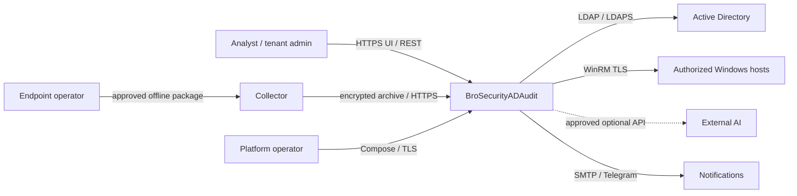
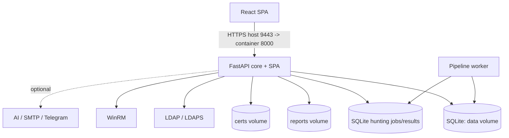

# System Architecture Description (SAD)

## Context

## Container view

Compose `init` sets volume ownership; `ad-security-core` serves HTTPS/API/UI; `ad-security-pipeline-worker` processes asynchronous hunting jobs and shares persistent data/report volumes. Worker startup is health-gated on core. Default deployment is single-host, not HA.

## Components

| Component | Responsibility |
| --- | --- |
| `app/main.py` | FastAPI routes, auth/session, tenant resolution, directory audit and hunting registration. |
| `app/database.py` | Core SQLite initialization/persistence. |
| `hunting_profiles.py`, `hunting_builder.py`, `hunting_packager.py` | Profile validation, allowlisted query build and package/spec/guide. |
| `hunting_ingest.py`, `hunting_results.py` | Encrypted import, evidence storage, integrity, paging and export. |
| `hunting_pipeline.py`, `hunting_pipeline_worker.py` | Durable async jobs, claim/heartbeat/recovery. |
| `hunting_analysis.py`, `hunting_correlation.py`, `hunting_windows_queries.py` | Deterministic analysis and gated query definitions. |
| `hunting_ai*`, `external_analysis*` | Optional bounded AI/external analysis and citation validation. |
| `frontend/`, built SPA | User-facing profile, scan, evidence and reporting workflows. |

## Data flow

1. Analyst creates tenant-scoped profile; API validates OS, artifact allowlist, aggregate limits and timeout.
2. Compiler emits packageable sources only; candidate sources fail closed. Operator reviews spec/guide.
3. Authorized operator executes collector on approved host. It creates encrypted results; collection is live response and changes endpoint state.
4. Analyst uploads over authenticated HTTPS. API resolves tenant key, validates archive/size/schema and SHA-256, then records import.
5. Durable job is queued; worker processes normalized rows and writes status/results into shared SQLite persistence.
6. UI polls status. Analyst checks source coverage, missing/empty/truncated states, findings and exact rows.
7. Reviewed reports can be exported. Optional AI gets bounded context; citation membership does not prove semantic support; human review is required.
8. Retention/purge follows tenant policy and backup obligations.

## Trust boundaries and integrations

Browser/API uses HTTPS, session authentication and tenant authorization. Collector execution is privileged and authorized live response. Archives and embedded claims are untrusted. Restrict host/Docker/volume access: `data` includes SQLite and tenant keys, `reports` reports, `certs` TLS material. LDAP/LDAPS and WinRM are outbound; verify TLS and allowlist. AI/SMTP/Telegram require explicit data-handling approval and secret protection.

REST contracts are in [OpenAPI](openapi.json) and [API/database reference](API_DATABASE.md). Internal worker coordination uses persistent SQLite; it is not a separate public queue. SQLite and single-host deployment require measured capacity planning; multi-host active-active, external DB, HA queue and automatic failover are not claimed.

## Decisions

- Docker Compose keeps deployment self-hosted, with single-host availability boundary.
- SQLite minimizes dependencies but requires coordinated DB/key/report backups.
- Separate worker isolates long jobs; durable state and stale-job recovery support operation.
- Package allowlist excludes unvalidated telemetry until acceptance.
- Deterministic evidence-first triage works without external AI; AI remains advisory.
